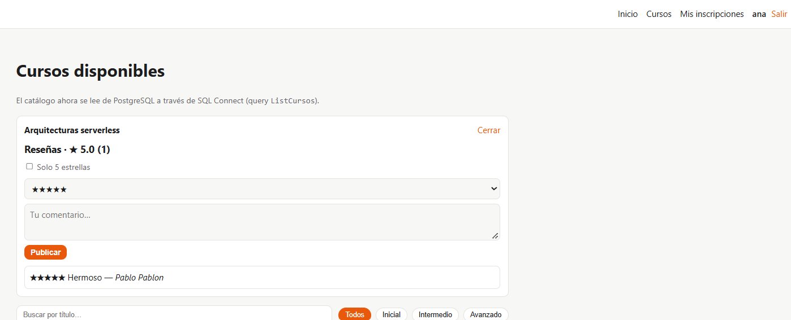
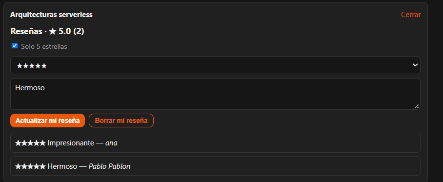
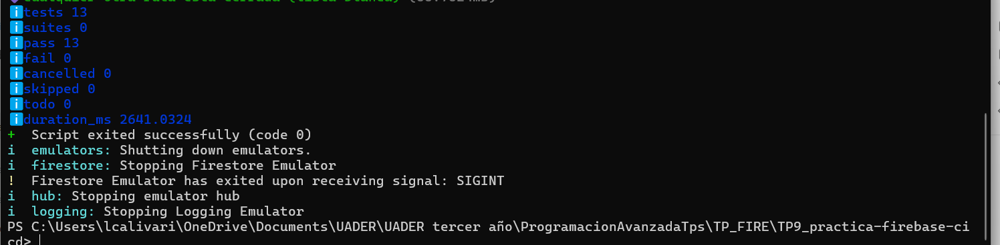
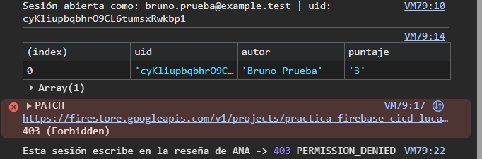

# Reflexión · CI/CD con Firebase Hosting

- **Repo:** https://github.com/LucasCalivari/TP9_practica-firebase-cicd
- **Producción:** https://practica-firebase-cicd-lucas.web.app
- **PR mergeado con comentario del bot y URL de preview:** https://github.com/LucasCalivari/TP9_practica-firebase-cicd/pull/1
  (también el PR #2, de la práctica de rollback, y el PR #3, de los headers)

---

## Mediciones (B1 y B5)

### Antes (B1) — producción sin tocar nada

`node scripts/check-headers.mjs https://practica-firebase-cicd-lucas.web.app`

```
▶ HTML: https://practica-firebase-cicd-lucas.web.app/
  status 200
  ✘ content-security-policy (falta)
  ✔ strict-transport-security: max-age=31556926; includeSubDomains; preload
  ✘ x-content-type-options (falta)
  ✘ x-frame-options (falta)
  ✘ referrer-policy (falta)
  ✘ permissions-policy (falta)
  · cache-control: max-age=3600

▶ Asset estático: /_next/static/chunks/1x6obpmlu1_c2.js
  ✘ cache-control: max-age=3600

❌ 6 control(es) pendiente(s).
```

securityheaders.com: **D**.

### Después (B5) — producción tras mergear el PR #3

```
▶ HTML: https://practica-firebase-cicd-lucas.web.app/
  status 200
  ✔ content-security-policy: default-src 'self'; script-src 'self' 'sha256-JMk7ugqSmWqqOKBSsQDDagqqviLnqht3hmvCInUaHrg=' 'sha256-OBTN3RiyCV…
  ✔ strict-transport-security: max-age=31556926; includeSubDomains; preload
  ✔ x-content-type-options: nosniff
  ✔ x-frame-options: DENY
  ✔ referrer-policy: strict-origin-when-cross-origin
  ✔ permissions-policy: camera=(), microphone=(), geolocation=()
  · cache-control: no-cache

▶ Asset estático: /_next/static/chunks/1x6obpmlu1_c2.js
  ✔ cache-control: public, max-age=31536000, immutable

✅ Todos los controles pasaron.
```

securityheaders.com: **A+**.

---

## Preguntas de reflexión

### 1. ¿Por qué el preview tiene vencimiento? ¿Qué riesgos tendría un preview que no vence nunca?

Cada PR crea un canal con una URL pública. Si no vencieran, se acumularían URLs con código sin revisar, a veces con bugs o con vulnerabilidades que se corrigieron después en otro commit. Esas URLs seguirían accesibles para cualquiera que las conozca, consumirían cuota del plan y harían difícil saber qué está publicado. Con `expires: 3d` el canal se borra solo cuando ya cumplió su función (la revisión del PR).

### 2. ¿Qué diferencia hay entre desplegar y liberar? ¿Dónde aparece cada concepto en este flujo?

**Desplegar** es poner una versión del código en un entorno; **liberar** es hacerla visible para los usuarios reales.

- Desplegar: cada PR se despliega a un canal de preview, que existe pero ningún usuario ve. Producción no cambió (lo verifiqué en el PR #2).
- Liberar: el merge a `main` publica en el canal `live`. El rollback también es una liberación, ya que reapunta `live` a una versión anterior sin reconstruir nada. `hosting:clone` permite liberar un preview sin recompilar.

### 3. ¿Por qué la clave de la service account va en un secreto y no en el repo? ¿Qué podría hacer alguien que la obtenga? ¿Cómo limitarías el daño?

Si estuviera en el repo, quedaría en el historial de git para siempre (y el repo es público), y cualquiera podría usarla. Con la clave, alguien puede desplegar contenido arbitrario en nuestro sitio (defacement, phishing, malware) o borrar versiones del hosting, con la identidad de la service account.

Para limitar el daño: dar a la service account el mínimo permiso necesario (solo Hosting, no Editor del proyecto); rotar la clave periódicamente y revocarla si se filtra; usar Workload Identity Federation (autenticación sin claves de larga duración); asociar el job de producción a un Environment `production` con aprobación manual; y que los PRs de forks no tengan acceso a los secretos (GitHub ya lo hace).

### 4. La CSP rompió la app: ¿por qué? ¿Qué opciones evaluaste y qué costo de seguridad tiene cada una?

Rompió dos cosas:

1. **El filtro de `/cursos` dejó de responder.** El export estático de Next.js incluye scripts *inline* (`self.__next_f.push(...)`) que arrancan la hidratación de React. Con `script-src 'self'` el navegador los bloquea y la página queda estática. La consola lo indicaba con el hash exacto de cada script.
2. **La foto de portada no cargó.** `img-src 'self'` bloquea `picsum.photos`. Además esa URL responde 302 a `fastly.picsum.photos`, y CSP valida cada salto de la redirección, así que hay que permitir los dos orígenes.

Opciones para los scripts inline:

| Opción | Costo de seguridad |
|---|---|
| `'unsafe-inline'` | Alto: permite cualquier script inline, incluido uno inyectado por un atacante (XSS). Casi anula la CSP. |
| Nonce por request | No es viable: no hay servidor, el HTML es estático y no puede cambiar el nonce en cada respuesta. |
| **Hashes SHA-256** (elegida) | Bajo: solo se ejecutan esos scripts exactos. Costo operativo: los hashes cambian en cada build. |

Implementé los hashes con `scripts/csp-hashes.mjs`, que corre después de `next build` (está encadenado en `npm run build`). Lee `out/*.html`, calcula el hash de cada script inline y reescribe la directiva `script-src` de `firebase.json`. Como el pipeline ejecuta `npm run build`, los hashes siempre coinciden con el build que se despliega (verifiqué que el preview y producción tienen hashes distintos al de mi máquina). Para imágenes, permití los dos orígenes exactos en `img-src`, no `https:` completo.

### 5. Para cada header de B2, ¿qué ataque mitiga?

| Header | Valor | Ataque que mitiga |
|---|---|---|
| `Strict-Transport-Security` | `max-age=31536000; includeSubDomains` | Downgrade a HTTP y SSL stripping (intermediario en una red pública). El navegador recuerda un año que solo se accede por HTTPS. |
| `X-Content-Type-Options` | `nosniff` | MIME sniffing: evita que el navegador interprete como script un archivo subido con otro tipo. |
| `X-Frame-Options` | `DENY` | Clickjacking: nadie puede embeber el sitio en un iframe para engañar al usuario. |
| `Referrer-Policy` | `strict-origin-when-cross-origin` | Fuga de URLs completas (rutas y parámetros) a sitios externos; solo envía el origen y solo por HTTPS. |
| `Permissions-Policy` | `camera=(), microphone=(), geolocation=()` | Uso de APIs sensibles (cámara, micrófono, ubicación) por la página o por scripts inyectados. |
| `Content-Security-Policy` | ver `firebase.json` | XSS: restringe de dónde se pueden cargar scripts, estilos e imágenes. `frame-ancestors 'none'` es el equivalente moderno de X-Frame-Options; `object-src 'none'` bloquea plugins; `base-uri 'self'` evita cambiar la URL base. |

Observación: en producción, Firebase Hosting responde con su propio HSTS (`max-age=31556926; includeSubDomains; preload`) y no con el que definí en `firebase.json`. La plataforma impone el suyo, así que el valor que escribí no se refleja, aunque el efecto es equivalente.

### 6. ¿Por qué los assets de `/_next/static/` pueden cachearse un año y el HTML no?

Los archivos de `/_next/static/` llevan un hash del contenido en el nombre. Si el código cambia, cambia el nombre, y el navegador pide una URL nueva. Por eso el contenido de esa URL nunca cambia y puede cachearse un año como `immutable`.

El HTML tiene siempre la misma URL (`/`, `/cursos`) pero su contenido cambia con cada deploy: apunta a los assets nuevos. Si se cacheara sin revalidar, los usuarios seguirían viendo la versión vieja. Con `no-cache` el navegador revalida en cada visita (si no cambió, la respuesta es un 304 corto). Esto impacta directamente en los deploys y rollbacks: un deploy o un rollback se ve de inmediato porque el HTML nunca queda desactualizado.

### 7. Si la app necesitara SSR, ¿qué cambiaría en la arquitectura, en la CSP y en el costo?

- **Arquitectura:** Firebase Hosting solo sirve estáticos. Con SSR habría que usar App Hosting (sobre Cloud Run) o Cloud Run/Functions detrás de Hosting. Dejaría de existir el `output: "export"`.
- **CSP:** al haber servidor se podría generar un **nonce por request** (por ejemplo en un middleware de Next.js) y usar `script-src 'nonce-...'`, en lugar de hashes calculados en el build. Sería más simple de mantener y tan estricto como los hashes, pero hay que cuidar que el HTML no se cachee en CDN (porque el nonce cambia).
- **Costo:** App Hosting y Cloud Run exigen el plan Blaze (con cuenta de facturación). Se pasa de costo cero (Spark) a pago por uso (requests, CPU, memoria), con riesgo de cargos si hay tráfico inesperado.

---

## Pregunta extra de A6: tras el rollback, `main` sigue teniendo el código nuevo. ¿Qué pasa con el próximo merge?

El rollback solo reapunta `live` a una versión anterior; `main` no cambia. Entonces el próximo merge vuelve a desplegar el código "malo" (junto con lo que traiga ese PR) y deshace el rollback sin avisar. En la práctica lo resolví con `git revert -m 1 <merge>` sobre `main`, que generó un deploy con el estado anterior, y así repo y producción volvieron a coincidir. En un equipo real: rollback inmediato para apagar el incendio, después `git revert` (o un fix) en `main`, y recién entonces se vuelve a mergear.

---

## Concurrencia y environment (A4 y A5)

**Preview (`firebase-hosting-pull-request.yml`).** Agregué `concurrency` con `group: preview-<número de PR>` y `cancel-in-progress: true`. Si se pushea de nuevo al mismo PR, el build anterior se cancela porque ya está desactualizado y solo importa el último commit. El grupo es por PR, así que dos PRs distintos no se cancelan entre sí.

Lo probé con el PR #6 (rama `test/concurrency`): abrí el PR y, mientras corría el primer run (evento `opened`), pusheé un commit vacío. El primer run quedó en estado **Cancelled** a los 31 s (un build completo tarda unos 40 s), con la anotación `Canceling since a higher priority waiting request for preview-6 exists` (`preview-6` es el grupo de concurrencia de ese PR), y el segundo (evento `synchronize`) terminó en verde.

**Producción (`firebase-hosting-merge.yml`).** Agregué `concurrency` con `group: production-deploy` y `cancel-in-progress: false`. Dos deploys nunca corren en paralelo, pero tampoco se corta uno en curso: el nuevo espera en fila. Cortar un deploy a mitad de camino podría dejar producción en un estado inconsistente, mientras que esperar solo cuesta unos segundos.

**Environment `production` (A5).** El job de producción tiene `environment: production` con la URL del sitio. GitHub lo creó solo en el primer deploy y desde entonces cada run de producción muestra el link al sitio y queda registrado en el historial de deployments. No activé "Required reviewers": como el repo es de una sola persona, exigir aprobación manual solo agregaría un clic en cada deploy. En un equipo real sí lo activaría, porque agrega una barrera humana antes de tocar producción y permite restringir qué ramas pueden desplegar.

---

## Problemas encontrados

- `firebase init hosting:github` terminó con "unexpected error" después de crear el secreto: la herramienta intenta leer los workflows existentes y falla porque su trigger es solo `workflow_dispatch`. No afectó el resultado (el secreto ya estaba creado).
- El emulador de Hosting no aplicaba ningún header en Windows. La causa es `glob-slash`, que usa `path.normalize` y devuelve `\` en lugar de `/`, por lo que los patrones de `source` nunca coinciden. Lo resolví con un parche local en `node_modules/glob-slash` usando `path.posix` (no se versiona; en Linux, donde corre GitHub Actions, no ocurre).
- `git revert` de un merge commit requiere `-m 1`.


---
---

## Clase 2 · SQL Connect

- **Repo:** https://github.com/LucasCalivari/TP9_practica-firebase-cicd (mismo repo y mismo proyecto Firebase que la clase 1)
- **PR mergeado con el cambio de CSP (L6) y toda la clase 2:** https://github.com/LucasCalivari/TP9_practica-firebase-cicd/pull/8
- **Producción:** https://practica-firebase-cicd-lucas.web.app

### Decisiones de modelado y operaciones (L1 a L5)

- **L1 · `Matricula`:** tabla intermedia con `@table(key: ["alumno", "curso"])` (clave primaria compuesta) y `fecha: Timestamp! @default(expr: "request.time")`. El emulador generó `PRIMARY KEY (alumno_id, curso_id)`, una clave foránea hacia `alumno` con `ON DELETE CASCADE` y un índice por cada clave foránea.
- **L2 · `Inscribirme($cursoId)`:** `@auth(level: USER)`, el alumno sale de `alumnoId_expr: "auth.uid"` y usa `matricula_upsert`. Con `matricula_insert`, una segunda inscripción al mismo curso falla por clave duplicada; con `upsert` la fila ya existente simplemente se actualiza, así que repetir la operación no falla ni duplica (es idempotente). `fecha` no se envía: la completa el servidor.
- **L3 · `MisInscripciones`:** `@auth(level: USER)`, busca con `alumno(key: { id_expr: "auth.uid" })` y no recibe ningún id como variable. La respuesta usa el alias `matriculas: matriculas_on_alumno`, que es la forma que espera `app/mis-inscripciones`.
- **L4 · `ListAlumnos`:** estaba en `PUBLIC` ("lo necesita el panel de administración"), pero devolvía id, nombre y email de todos los alumnos sin login. La pasé a `NO_ACCESS`. Un panel de administración no debería llamar a esa operación desde el navegador: debería hacerlo desde un servidor con el Admin SDK, que no pasa por `@auth`. Una alternativa que no implementé sería dejar la operación en `USER` con una condición sobre un *custom claim* de administrador (`@auth(level: USER, expr: "auth.token.admin == true")`), asignado desde el Admin SDK.
- **L5 · `DarmeDeBaja($cursoId)`:** `matricula_delete(key: { alumnoId_expr: "auth.uid", cursoId: $cursoId })`. La clave se arma con el UID del token, así que solo se puede borrar una inscripción propia.
- **Ajuste en la app:** `misInscripciones()` ahora usa `fetchPolicy: QueryFetchPolicy.SERVER_ONLY`. Con la política por defecto del SDK (13.1.0), después de "Darme de baja" la lista seguía mostrando el dato viejo (se actualizaba recién con Ctrl+F5), porque la query estaba cacheada.

### Auditoría con `npm run atacar` (Parte C)

**Antes** (con `ListAlumnos` en `PUBLIC` y sin `Inscribirme`):

```
✔ ListCursos responde sin login (7 cursos) — público por diseño
✘ ListAlumnos devuelve datos personales SIN login
    Ejemplo filtrado: {"email":"ana@ejemplo.test","id":"seed-uid-ana","nombre":"Ana Ficticia"}
… Inscribirme todavía no existe (TODO L2)
… No se pudo inscribir al usuario A: no se pueden probar los controles de aislamiento
❌ 1 vulnerabilidad(es) · 2 pendiente(s)
```

**Después, con el script original** (L1 a L5 aplicados):

```
✔ ListCursos responde sin login (7 cursos) — público por diseño
✔ ListAlumnos rechazada para un cliente
✔ Inscribirme rechazada sin login
✔ Inscribirme es idempotente (repetir no falla)
✔ MisInscripciones solo devuelve lo del usuario que llama
✘ B logró borrar la inscripción de A
❌ 1 vulnerabilidad(es) · 0 pendiente(s)
```

**El último control es un falso positivo.** Lo verifiqué por separado: A se inscribe, B llama a `DarmeDeBaja` sobre el mismo curso y recibe `{"matricula_delete": null}` (no borró nada); después A sigue viendo su inscripción, antes y después de la llamada de B. El script decide con `m.curso?.id === CURSO`, pero el emulador devuelve los UUID **sin guiones** (`0b7c1a2e00014c3a9d5e000000000003`) y la constante `CURSO` del script los tiene **con guiones** (`0b7c1a2e-0001-4c3a-9d5e-000000000003`), así que la comparación nunca coincide. Se lo consulté a la cátedra, que confirmó el diagnóstico y autorizó normalizar la comparación en mi copia. Agregué `mismoUuid(a, b)` en `scripts/atacar.mjs` (compara sin guiones y en minúsculas) y reemplacé las dos comparaciones con `===`. **Después, con el script corregido** (`atacar-despues.txt`):

```
✔ ListCursos responde sin login (7 cursos) — público por diseño
✔ ListAlumnos rechazada para un cliente
✔ Inscribirme rechazada sin login
✔ Inscribirme es idempotente (repetir no falla)
✔ MisInscripciones solo devuelve lo del usuario que llama
✔ B no puede dar de baja a A
✅ Todos los controles pasaron
```

**Lo que enseña este caso.** La misma comparación se usaba en el control "B no ve la inscripción de A" (`deB.some(...)`), que con el bug daba siempre "ok" porque nunca encontraba el curso, aunque la regla de autorización estuviera mal. Es decir: **una prueba de seguridad que da verde no alcanza, también tiene que ser capaz de fallar.** Para comprobarlo con el script corregido, rompí a propósito `DarmeDeBaja` para que borrara por `cursoId` sin mirar quién llama (`matricula_deleteMany(where: { cursoId: { eq: $cursoId } })`) y la auditoría marcó correctamente `✘ B logró borrar la inscripción de A`. Después restauré la versión correcta desde git y volvió a dar `✅ Todos los controles pasaron`. Con el script original el resultado hubiera sido ✘ en los dos casos, sin distinguir una regla correcta de una rota.

### Producción (L6 y L7)

**L6 · CSP.** La CSP de la clase 1 no definía `connect-src`, así que caía en `default-src 'self'` y bloqueaba las llamadas a Google. Identifiqué los orígenes mirando la consola con el build de producción servido por el emulador de Hosting:

```
connect-src 'self' https://firebasedataconnect.googleapis.com https://identitytoolkit.googleapis.com https://securetoken.googleapis.com
```

| Origen | Para qué | Cómo lo verifiqué |
|---|---|---|
| `firebasedataconnect.googleapis.com` | Queries y mutations de SQL Connect | Observado como bloqueado en la consola |
| `identitytoolkit.googleapis.com` | Auth: registro e inicio de sesión (`accounts:signUp`) | Observado como bloqueado; con el origen permitido el registro funcionó |
| `securetoken.googleapis.com` | Auth: renovar el token de sesión (vence cada hora) | **Inferido, no observado**: en una prueba corta nunca se renueva el token |

**L7 · Deploy.** `npx firebase deploy --only dataconnect` habilitó `sqladmin.googleapis.com`, creó el servicio `catalogo`, desplegó el conector `cursos` y empezó a crear la instancia Cloud SQL `catalogo-fdc` (prueba sin costo). Mientras la instancia se crea, los datos se guardan en una base temporal y el CLI omitió la migración del esquema SQL. Después ejecuté `npx firebase dataconnect:execute dataconnect/seed_data.gql` (7 cursos y 2 alumnos de ejemplo). Con el build de producción, el catálogo carga los 7 cursos y el registro de usuarios funciona.

**Verificación de la migración.** Cuando la instancia terminó de crearse (tardó un rato), corrí `npx firebase dataconnect:sql:diff` y respondió:

```
Database schema of catalogo-fdc:fdcdb matches SQL Connect Schema exactly.
```

Es decir, el esquema SQL quedó aplicado en Cloud SQL sin diferencias respecto del esquema declarado en `schema.gql`: no hizo falta volver a ejecutar el deploy. El `sql:diff` sirve para auditar una migración antes de aplicarla y detectar divergencias entre la base real y lo que dice el código.

### Preguntas de reflexión

**1. ¿Por qué ninguna operación de este conector recibe el id del alumno como variable? ¿Qué es IDOR y cómo lo evita `auth.uid`?**
IDOR (*Insecure Direct Object Reference*) ocurre cuando una API acepta un identificador del objeto desde el cliente y no verifica que ese objeto sea del usuario que llama. Si `MisInscripciones` recibiera `$alumnoId` y filtrara por él, cualquiera podría leer las inscripciones de otro alumno cambiando ese valor, porque el código del cliente es público y la API se puede llamar directamente. Con `id_expr: "auth.uid"` el identificador sale del **token de Firebase Auth, que el servidor verifica**, así que el cliente no puede elegirlo. Es lo que OWASP llama *Broken Object Level Authorization* (API1).

**2. `ListCursos` es `PUBLIC` y `ListAlumnos` terminó en `NO_ACCESS`. ¿Qué criterio usaste? ¿Cómo haría el "panel de admin" para listar alumnos?**
El criterio fue qué datos devuelve y quién los necesita. El catálogo es información pública (por eso `PUBLIC` exige un `insecureReason` que lo justifique). `ListAlumnos` devuelve datos personales (nombre y email) y ningún cliente legítimo del navegador necesita todos los alumnos, así que `NO_ACCESS`. Los niveles son: `PUBLIC` (cualquiera, incluso sin login), `USER` (cualquier usuario autenticado) y `NO_ACCESS` (ningún cliente, solo herramientas de administración). El panel de administración debería listar alumnos desde un servidor con el Admin SDK (que no pasa por `@auth`) o, como alternativa, con una operación `USER` restringida por un *custom claim* de admin. Que el panel "sea solo para admins" no protege nada si la operación sigue siendo llamable por cualquiera.

**3. ¿Qué ventaja tiene una clave primaria compuesta en `Matricula` frente a validar duplicados en el código del cliente?**
La garantía la da la base de datos y es atómica: dos peticiones simultáneas, otro cliente, o una llamada directa a la API no pueden crear dos filas con el mismo par (alumno, curso). Una validación en el cliente se puede saltear (el atacante no usa tu interfaz) y además tiene condiciones de carrera (dos solicitudes comprueban "no existe" a la vez y las dos insertan). Una clave UUID propia en `Matricula` no evitaría duplicados sin una restricción `UNIQUE` adicional. La regla "un alumno, una inscripción por curso" vive mejor en la base de datos, que es la última barrera. Además, la clave compuesta es lo que permite que el `upsert` de `Inscribirme` sea idempotente.

**4. La configuración de Firebase (`apiKey`, etc.) es pública. ¿Por qué eso no compromete la base de datos? ¿Qué capa faltaría para frenar a alguien que usa esa config desde un script?**
Esa configuración solo **identifica** el proyecto, no da permisos: el acceso a los datos lo deciden Firebase Auth (quién sos) y las reglas `@auth` de cada operación (qué podés hacer). Con la config pública alguien solo puede hacer lo que una operación permite a un usuario anónimo (leer el catálogo) o a una cuenta que él mismo se cree. Lo que falta es una capa que verifique que la petición viene de **mi app y no de un script**: **App Check** (atestación del cliente) y, además, límites de cuota y de tasa. Sin eso, cualquiera puede crear cuentas con el script y consumir la cuota gratuita de operaciones.

**5. Comparado con una API REST propia (Express + `pg`), ¿qué te da SQL Connect y qué perdés?**
*Gano:* no hay endpoint que acepte SQL, el cliente solo invoca operaciones por nombre (la inyección SQL queda cerrada por diseño); la autorización se declara junto a cada operación (`@auth`) y no en código disperso; integración directa con Firebase Auth; no hay servidor que mantener ni desplegar; y emuladores locales para desarrollar. *Pierdo:* flexibilidad (lógica de negocio compleja, como controlar el cupo de un curso al inscribirse, es más difícil de expresar en una operación declarativa que en código propio), dependencia del proveedor (lock-in), menos control sobre caché y observabilidad (me pasó con la caché del SDK en "Darme de baja"), y límites del plan (la prueba gratuita es de 90 días, una por proyecto, con un tope de operaciones diarias).

**6. ¿Por qué no alcanzó con la CSP de la clase 1 y por qué conviene listar dominios exactos en `connect-src`?**
La CSP de la clase 1 no definía `connect-src`, así que las llamadas `fetch` heredaban `default-src 'self'` y el navegador bloqueaba toda comunicación con Auth y SQL Connect (`Refused to connect`). Conviene listar dominios exactos porque un comodín como `https://*.googleapis.com` también permitiría conectarse a cualquier otra API de Google, incluidas las de proyectos de un atacante (por ejemplo un bucket o una base propios), y un script inyectado podría **exfiltrar** datos del usuario a ese destino. Con los tres hosts exactos, la política permite lo que la app necesita y no más (principio de mínimo privilegio).


---
---

## Práctica 4 · Firestore

- **Repo:** https://github.com/LucasCalivari/TP9_practica-firebase-cicd (mismo repo y mismo proyecto Firebase que las clases anteriores)
- **PR mergeado con reglas, índice y CSP:** https://github.com/LucasCalivari/TP9_practica-firebase-cicd/pull/10
- **Producción:** https://practica-firebase-cicd-lucas.web.app

### Qué se construyó

| Pieza | Archivo |
|---|---|
| Capa de acceso a datos (escribir, escuchar en tiempo real, agregación) | `lib/resenas.ts` |
| Formulario, lista en vivo, resumen y filtro de 5 estrellas | `app/components/ResenasCurso.tsx` (montado en cada tarjeta del catálogo con un botón **Reseñas**, en `CatalogoSql.tsx`) |
| Reglas de seguridad | `firestore.rules` |
| Tests de reglas contra el emulador | `tests/reglas.test.mjs` |
| Índice compuesto como código | `firestore.indexes.json` |
| CSP con `https://firestore.googleapis.com` en `connect-src` | `firebase.json` |

Modelo de datos: `cursos/{cursoId}/resenas/{uid}` con `puntaje`, `texto`, `autor` y `creadaEn`. El id del documento es el UID del autor y `creadaEn` lo pone el servidor con `serverTimestamp()`. El `cursoId` es el UUID del curso en SQL Connect.

### Evidencia

**1. Tiempo real entre dos navegadores** (emulador local, cuentas distintas). A la izquierda, el navegador de Ana ve la reseña que Pablo publicó desde el otro; a la derecha, el de Pablo ve la de Ana, sin recargar la página:




La misma prueba se repitió después en el preview del PR, con cuentas reales y contra el Firestore de producción, sin errores.

**2. Tests de reglas: 13 en verde** (`npm run test:reglas`): los 8 casos de la consigna más 5 propios (texto vacío o de más de 500 caracteres, autor vacío o de más de 80, editar la reseña ajena, borrar la reseña ajena, y cualquier otra ruta cerrada).

```
✔ cualquiera puede leer reseñas, incluso sin login
✔ Ana puede crear SU reseña
✔ Ana NO puede crear una reseña a nombre de Bruno
✔ sin login no se puede escribir
✔ puntaje fuera de rango o con decimales se rechaza
✔ no se pueden agregar campos extra (p. ej. destacada: true)
✔ la fecha de creación la pone el servidor y no se puede cambiar
✔ el cliente no puede escribir el documento del curso
✔ el texto vacío o de más de 500 caracteres se rechaza
✔ el nombre del autor no puede estar vacío ni superar 80 caracteres
✔ Bruno NO puede editar la reseña de Ana
✔ Bruno NO puede borrar la reseña de Ana, pero Ana sí puede borrar la suya
✔ cualquier otra ruta está cerrada (lista blanca)
ℹ tests 13 · pass 13 · fail 0
```



**3. Haberlos hecho fallar.** Cambié en `firestore.rules` el tope `d.puntaje <= 5` por `<= 6` y volví a correr los tests. Se puso en rojo exactamente el que corresponde y los otros 12 siguieron en verde, de modo que los tests sí detectan el error:

```
✖ puntaje fuera de rango o con decimales se rechaza
    Error: Expected request to fail, but it succeeded.
ℹ pass 12 · fail 1
```

Después restauré `<= 5` y volvieron los 13 en verde. Un test de seguridad que nunca puede fallar no prueba nada.

**4. Seguridad en vivo contra producción.** Desde la consola del navegador, en el preview, con la sesión real de Bruno (su token de Firebase Auth), traté de escribir directamente en el documento de la reseña de Ana por la API REST de Firestore, salteando mi interfaz. Firestore respondió `403 PERMISSION_DENIED`:

```
Sesión abierta como: bruno.prueba@example.test | uid: cyKliupbqbhrO9CL6tumsxRwkbp1
Esta sesión escribe en la reseña de ANA -> 403 PERMISSION_DENIED
```



Un matiz: en ese curso la única reseña existente era la de Bruno, así que el intento fue de **crear** una reseña con el id de Ana y lo frenó la regla de creación (`esDuenio(uid)`). El caso de **editar** una reseña ajena que ya existe lo cubre el test automático `Bruno NO puede editar la reseña de Ana`.

### Decisiones, cambios respecto del PDF y problemas encontrados

- **Índice compuesto (Paso 8).** Declaré `puntaje` ascendente y `creadaEn` descendente en `firestore.indexes.json` y lo desplegué con `firebase deploy --only firestore:rules,firestore:indexes`. El emulador de Firestore **no exige índices**: la consulta de "Solo 5 estrellas" funciona en desarrollo aunque falte el índice, y la falla (`FAILED_PRECONDITION`) aparece recién en producción. Por eso los índices tienen que estar declarados en el repo y desplegarse, no depender de lo que se vea en local.
- **Reglas más estrictas que las de la consigna.** Agregué `texto.size() >= 1` y `autor.size() >= 1` (no se aceptan reseñas vacías) y los tests correspondientes.
- **`guardarResena` consulta si la reseña existe** con `getDoc`, en lugar de confiar en la lista en pantalla (limitada a 20 y posiblemente filtrada): si mi reseña no estuviera en esa lista, se intentaría crear de nuevo con `serverTimestamp()` y las reglas rechazarían el cambio de fecha.
- **Escrituras pendientes.** `onSnapshot` usa `includeMetadataChanges: true` y cada reseña lleva `pendiente: d.metadata.hasPendingWrites`, así la interfaz muestra "(enviando…)" hasta que el servidor confirma. Esos avisos de solo metadatos no consumen lecturas.
- **El resumen se quedaba desactualizado.** Probando con dos navegadores vi que, justo después de publicar, la lista tenía 2 reseñas pero el título decía `★ 5.0 (1)`. La lista se actualiza al instante (compensación de latencia) pero la agregación la calcula el servidor, que todavía no tenía la escritura confirmada. Además, editar el puntaje no cambia la cantidad, así que no se volvía a pedir. Lo corregí: el resumen se vuelve a calcular cuando cambia el contenido de la lista (uid y puntaje de cada reseña, no solo la cantidad) y cuando el servidor confirma una escritura propia, y se descartan las respuestas viejas que lleguen tarde.
- **Node 24 y `node --test tests/`.** El script del PDF falla en Node 24 porque toma `tests/` como si fuera un archivo y no como una carpeta. Usé `node --test tests/*.test.mjs`.
- **El emulador de Firestore no arrancaba en Windows.** Java 24 usa un socket de archivo en la carpeta temporal para armar un pipe interno, y fallaba con `Unable to establish loopback connection` / `Invalid argument: connect`. Lo resolví apuntándolo a una carpeta corta (`JAVA_TOOL_OPTIONS=-Djdk.net.unixdomain.tmpdir=C:\javatmp`). Además, el `java.exe` del PATH es un lanzador intermedio y, al terminar, el emulador quedaba **huérfano** ocupando el puerto 8080; poniendo el JDK directo al principio del PATH (`C:\Program Files\Java\jdk-24\bin`) se cierra solo.
- **Limitación de diseño que conviene reconocer.** Las reglas **no verifican que quien reseña esté inscripto** en el curso: esa información vive en PostgreSQL (SQL Connect) y Firestore no puede consultarla desde las reglas. Hoy cualquier usuario autenticado puede reseñar cualquier curso. Para exigirlo habría que validarlo del lado del servidor (Práctica 5).
- **`autor` no es verificable.** Es un texto que manda el cliente; las reglas solo validan tipo y largo, así que alguien podría escribir el nombre de otra persona. Se podría exigir que coincida con el nombre del token de Auth (`request.auth.token.name`) desde las reglas.

### Preguntas de reflexión

**1. ¿Por qué el id del documento es el UID? ¿Qué tendrías que agregar (en reglas o en código) si usaras ids aleatorios con `addDoc`?**
Porque así "una reseña por persona y curso" queda garantizado por la **estructura**: escribir de nuevo apunta al mismo documento y lo actualiza, sin duplicar. Además las reglas pueden comparar el id con `request.auth.uid` (`esDuenio(uid)`) sin leer nada más. Con ids aleatorios (`addDoc`) tendría que (a) guardar un campo `uid` en el documento y exigir en las reglas que `request.resource.data.uid == request.auth.uid`, para saber quién es el dueño al editar o borrar (con `resource.data.uid`); y (b) resolver aparte la unicidad: las reglas no pueden prohibir una segunda reseña del mismo usuario sin una consulta (no admiten consultas por campo), así que hace falta una convención de id, una transacción o una Cloud Function. Y para mostrar "mi reseña" habría que hacer una consulta `where("uid", "==", mi_uid)` en vez de leer directamente un documento.

**2. La reseña guarda una copia del nombre del autor. ¿Qué ganás y qué perdés con esa desnormalización? ¿Cómo resolverías el cambio de nombre?**
*Gano:* mostrar la lista no requiere una lectura adicional por reseña para buscar el nombre; con `limit(20)` es una sola consulta, menos lecturas (y cuota) y menos latencia. *Pierdo:* consistencia, porque si alguien cambia su nombre, sus reseñas viejas conservan el anterior; y el nombre lo manda el cliente, así que hoy no es verificable (podría escribir el de otro). Para el cambio de nombre: una Cloud Function que, al actualizar el perfil, actualice las reseñas de ese usuario (para encontrarlas hace falta un campo `uid` y una consulta de grupo de colección); o guardar solo el UID y buscar el nombre en un documento de perfil público al mostrar la lista (más lecturas); o aceptar que las reseñas históricas conservan el nombre de cuando se escribieron. Para la verificación, la regla puede exigir `autor == request.auth.token.name`.

**3. ¿Qué diferencia hay entre `resource.data` y `request.resource.data`? Dá un ejemplo de regla que use ambos.**
`resource.data` es el documento **como está guardado ahora** (antes de la escritura; no existe al crear). `request.resource.data` es el documento **como quedaría después** de la escritura (en una actualización con `merge`, ya combinado con lo existente). Mi regla de edición usa los dos: `request.resource.data.creadaEn == resource.data.creadaEn`, que dice que la fecha resultante tiene que ser igual a la que ya estaba guardada (la fecha es inmutable), mientras que `resenaValida()` valida el estado final con `request.resource.data`.

**4. ¿Por qué la regla de creación exige `creadaEn == request.time` en lugar de confiar en la fecha del cliente?**
El reloj del cliente no es confiable: puede estar mal configurado o ser manipulado a propósito, y con eso alguien podría postergar o adelantar sus reseñas, o ponerlas primero en el orden por fecha. `serverTimestamp()` se resuelve en el servidor y es igual a `request.time`, por lo que exigir esa igualdad garantiza que la fecha es la hora real de la escritura y que el orden de la lista no se puede falsear. En el test se ve: crear con una fecha de 2020 falla; con `serverTimestamp()` funciona; y después de creada no se puede cambiar.

**5. ¿Qué limitación tiene `getAggregateFromServer` y cómo afecta la experiencia de usuario? ¿Qué alternativas hay?**
No funciona con *listeners* en tiempo real ni offline: se calcula en el servidor cada vez que se pide, así que el resumen (promedio y cantidad) no se actualiza solo como la lista. Lo viví en la práctica: tras publicar, el título quedó con el número viejo hasta que lo volví a pedir cuando el servidor confirmó la escritura. Además cada pedido cuesta una lectura por cada lote de 1.000 entradas de índice. Alternativas: mantener el resumen (`cantidad` y `suma`) dentro del documento del curso, actualizado desde el servidor con una Cloud Function (es lo que se plantea en la Práctica 5) y escucharlo con `onSnapshot`; contadores distribuidos si hay muchas escrituras por segundo; o calcular el promedio en el cliente con las reseñas ya cargadas, que es barato pero inexacto con más de 20.

**6. Para inscripciones con cupo máximo, ¿usarías Firestore o SQL Connect? Justificá con lo que viste en las dos prácticas.**
**SQL Connect (PostgreSQL).** Una inscripción con cupo necesita que "contar las inscriptas y agregar una más" sea **atómico y consistente**, y que el dato de las inscripciones sea íntegro: la clave primaria compuesta de `Matricula` ya garantiza una inscripción por alumno y curso, y las claves foráneas impiden inscribir a un alumno o un curso inexistente. En Firestore las reglas no pueden consultar cuántos documentos hay (no hay `COUNT` en las reglas), así que para controlar el cupo hace falta una transacción del lado del servidor o un contador en un documento, que además se vuelve un punto caliente de escritura. Firestore es mejor para lo que vimos hoy: reseñas en vivo, sin relaciones que validar, donde lo importante es que el cliente lea y escriba directo y reciba los cambios en tiempo real. Son herramientas para problemas distintos: relacional para integridad y cupos, documental para tiempo real y flexibilidad.
